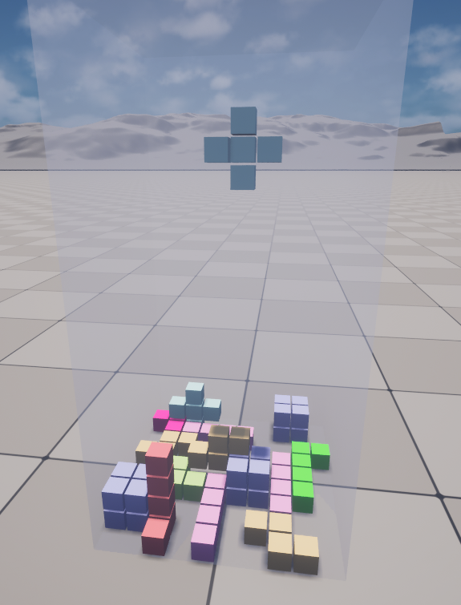

# 俄罗斯方块 3D

使用 Unreal Engine 5.8 蓝图制作的俄罗斯方块游戏。本仓库包含主玩法蓝图、数据表、材质、UMG、音效与主关卡 NewMap1。

## 功能

- 方块下落、旋转与位置检查。
- 消行、计分和暂停。
- 数据表配置方块形状。
- 主菜单、暂停菜单与分数 HUD。

## 蓝图入口

- [`Content/BluePrint`](Content/BluePrint)：`BP_TetrisBoardManager` 处理棋盘与游戏规则，`BP_BasicBlock`、`BP_HighLight` 和状态枚举提供相关表现与状态。
- [`Content/DataSystem`](Content/DataSystem)：方块形状数据表和结构体。
- [`Content/UI`](Content/UI)：菜单、暂停与分数界面。
- [`Content/Material`](Content/Material)：方块相关材质。

## 在 UE 中查看

使用 UE 5.8 打开 `俄罗斯方块3d.uproject`，在内容浏览器中打开以上蓝图。GitHub 网页不能直接展开 `.uasset` 蓝图图表，需要在 UE 编辑器中查看。

打开 `/Game/NewMap1` 后运行 PIE。仓库保留了该关卡的 World Partition 外部 Actor/Object 数据及原工程所保留的模板依赖，不包含其他旧关卡、旧演示和本地编辑器工具。本次发布检查文件与依赖包路径，尚未对公开副本执行完整 PIE 游玩回归。

Unreal Engine 和模板相关内容遵循 Epic 的适用许可；本仓库不分发引擎或开发缓存。

[作品集](https://wcy1213812138.github.io/)

## 运行画面

